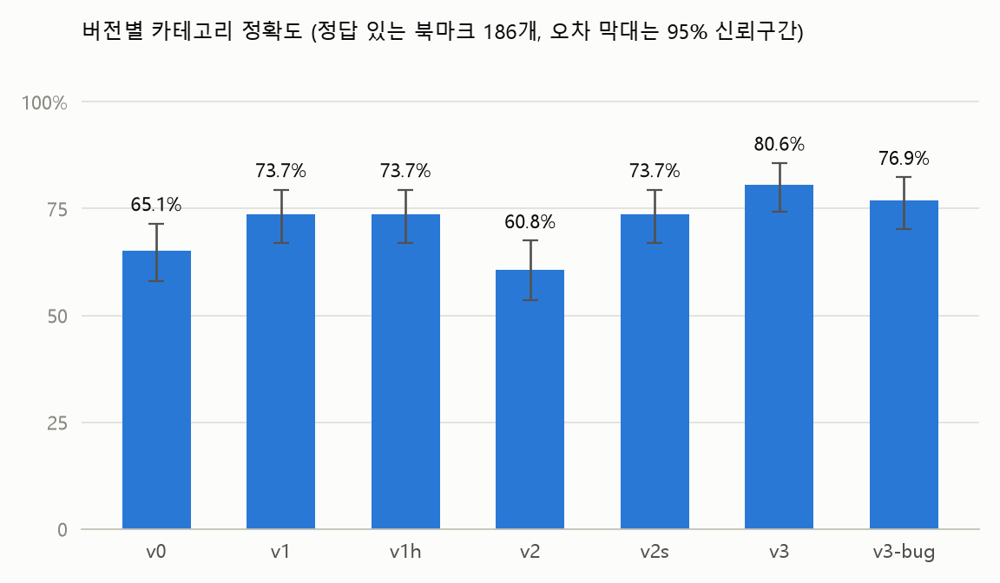

# AI 카테고리/태그 추천 정량 평가

Today Bookmark 확장앱의 AI 추천(`apps/extension/src/lib/claude.ts`)을 고정된 평가셋으로 측정하는 하네스.
앱 코드는 수정하지 않고, 프롬프트 구성 로직만 복사해서 쓴다 (`scripts/00_check_sync.ts`가 원본과 같은지 검사).

## 결과 요약 (2026-11-15)

고정 평가셋 199개에서 카테고리 정확도는 초기 버전 **65.1% → 현재 버전 80.6%** (+15.6%p, McNemar p<0.001). 가장 효과가 컸던 개선은 본문 보강(확장 메타데이터, X 링크의 Jina Reader 본문)으로 +8.6%p였고, few-shot 예시가 +7.0%p였다. 카테고리 설명과 하이퍼파라미터 조정은 정확도를 바꾸지 못했다. 전체 내용은 [results/report.md](results/report.md).

| 버전 | 직전에서 바뀐 것 | 정확도 (95% CI) | 오선택 | 누락 | 억지 배정 | 건당 비용 |
|---|---|---|---|---|---|---|
| v0 | 초기 버전 | 65.1% (58.0~71.5) | 31.2% | 3.8% | 100% | $0.00074 |
| v1 | + 메타데이터 확장, Jina 본문 | 73.7% (66.9~79.5) | 22.0% | 4.3% | 84.6% | $0.00130 |
| v1h | + max_tokens 400, temperature 0 | 73.7% (66.9~79.5) | 21.5% | 4.8% | 100% | $0.00118 |
| v2 | + 카테고리 설명 | 60.8% (53.6~67.5) | 18.8% | 20.4% | 69.2% | $0.00131 |
| v2s | + system 프롬프트 분리 | 73.7% (66.9~79.5) | 24.2% | 2.2% | 100% | $0.00157 |
| **v3** | + few-shot 5개 (현재 앱) | **80.6% (74.4~85.7)** | 18.8% | 0.5% | 100% | $0.00211 |
| v3-bug | few-shot에 미분류 예시 2개 | 76.9% (70.3~82.4) | 22.0% | 1.1% | 100% | $0.00210 |

정확도, 오선택, 누락은 정답이 있는 북마크 186개, 억지 배정은 어느 카테고리에도 맞지 않는 북마크 13개 기준이다. 모델은 `claude-haiku-4-5-20251001`, 버전당 3회 반복의 다수결. v2의 하락은 재구성한 프롬프트에서 출력 형식이 깨진 영향이 크다 (보고서 5장).



**한계**

- 표본이 작다. 정확도 신뢰구간이 ±6~7%p이고, NONE은 13개, 일반 웹 페이지는 34개뿐이다.
- 중간 버전(v1~v2s)은 실제 배포된 적 없이 개선을 하나씩 얹어 재구성한 것이다.
- 정답은 사용자가 저장한 카테고리라서 AI 추천을 그대로 수락한 라벨이 섞여 있을 수 있다.
- 앱은 브라우저 DOM을 읽지만 평가는 서버 HTML을 읽는다. 앱은 Jina를 2.5초에서 끊지만 평가는 30초까지 기다렸다.
- 카테고리 설명은 실패 사례를 본 뒤에 쓴 것이라 설명을 쓰는 버전에 유리할 수 있다.

## 준비

```bash
cd eval
npm install                      # linkedom 하나만 설치됨
python -m pip install pandas matplotlib
cp .env.example .env             # SUPABASE_SERVICE_ROLE_KEY 입력
```

- Node 23.6 이상 필요 (TypeScript를 빌드 없이 바로 실행).
- Supabase URL, Claude API 키, Jina 키는 `apps/extension/.env` 값을 그대로 읽는다.

## 실행 순서

| 단계 | 명령 | 결과 |
|---|---|---|
| 0. 앱 코드와 동기화 검사 | `node scripts/00_check_sync.ts` | |
| 1. 추출 | `node scripts/01_export.ts` | `data/bookmarks_raw.json` |
| 1b. 샘플링, 라벨 초안 | `node scripts/01b_sample.ts` | `data/labels.csv` (사람이 검토) |
| 2. 스냅샷 수집 | `node scripts/02_snapshot.ts` | `data/snapshots/*.json`, `data/snapshot_status.csv` |
| 3. 프롬프트 확인 | `node scripts/03_run.ts --dry-run --limit 1` | API 호출 없음 |
| 3. 시범 실행 | `node scripts/03_run.ts --limit 10 --runs 1` | `runs/<버전>.jsonl` |
| 3. 전체 실행 | `node scripts/03_run.ts` | 3회 반복, 캐시된 호출은 건너뜀 |
| 4. 분석 | `python analysis/analyze.py` | `results/` |

### 링크를 따로 추가하려면

`data/extra_links.csv`에 `url,gold_category,note`를 적고 `01b_sample.ts` → `02_snapshot.ts`를 다시 실행한다.
`gold_category`는 카테고리 이름 또는 `NONE`(어느 카테고리에도 안 맞음). 기존 `labels.csv`의 행은 그대로 유지되고 새 항목만 뒤에 붙는다.

### labels.csv 컬럼

| 컬럼 | 설명 |
|---|---|
| `gold_category` | 정답 카테고리 이름. 맞는 것이 없으면 `NONE` |
| `gold_tags` | 정답 태그 (쉼표 구분, 비워도 됨) |
| `ambiguous` | 두 카테고리가 모두 말이 되면 `1` |
| `alt_category` | 경계 사례에서 허용할 두 번째 카테고리 |
| `label_source` | `user_final`(저장된 값 그대로) / `relabeled`(검토 중 수정) / `added`(따로 추가한 링크) |
| `exclude` | `1`이면 평가에서 제외 |

## 버전

| 버전 | 프롬프트 틀 | 입력 | 카테고리 | few-shot | 하이퍼파라미터 |
|---|---|---|---|---|---|
| v0 | 초기 (단일 user 메시지) | title, url, description | 이름만 | 없음 | max_tokens 128, temperature 기본값, 태그 전체 |
| v1 | 초기 | + site, keywords, 본문 (X는 Jina) | 이름만 | 없음 | v0과 동일 |
| v1h | 초기 | v1과 동일 | 이름만 | 없음 | max_tokens 400, temperature 0, 태그 상위 50개 |
| v2 | 초기 | v1과 동일 | + description | 없음 | 최종값 |
| v2s | 현재 (system 분리) | v1과 동일 | + description | 없음 | 최종값 |
| v3 | 현재 | v1과 동일 | + description | 분류된 최근 5개 | 최종값 (현재 앱) |
| v3-bug | 현재 | v1과 동일 | + description | 최근 5개 중 2개를 미분류로 바꿈 | 최종값 (1차 회귀를 인위적으로 재현) |

git 히스토리에는 v0(`4568d01`)과 현재 버전만 있다. 중간 버전은 개선을 하나씩 얹어 재구성한 것이다.

## 설계상 지킨 것

- **누수 방지**: few-shot 예시와 태그 풀은 대상 북마크보다 먼저 저장된 북마크에서만 만든다. 평가셋의 다른 북마크가 예시로 쓰인 경우는 `fewshot_in_evalset`에 기록한다.
- **같은 입력**: 모든 버전이 같은 스냅샷을 쓴다.
- **같은 파서**: 주 비교는 모든 버전에 현재 파서를 적용한다. 버전의 원래 파서 결과는 `parse_ok_original`에 따로 남긴다.
- **카테고리 별칭**: `data/category_alias.json`(gitignore)에 `{"실제 이름": "공개용 이름"}`을 적으면 `results/`의 표에는 공개용 이름만 나온다. 실제 이름은 커밋되는 파일에 적지 않는다.
- **개인 데이터**: `data/`와 `runs/`는 gitignore. 카테고리 이름이나 개별 북마크가 드러나는 표는 `runs/analysis_private/`에 쓴다. `results/`에는 집계만 들어간다.

## 알려진 한계

- 앱은 렌더링된 DOM의 `innerText`를 읽지만 평가는 서버 HTML의 `textContent`를 쓴다.
- 앱은 Jina Reader를 2.5초에서 끊지만 평가는 30초까지 기다린다. 실제 사용보다 본문이 더 자주 채워진다.
- X 링크의 title은 저장 당시 확장앱이 추출한 DB 값을 쓴다. description은 DB에 전부 비어 있다.
- AI 추천값과 사용자가 확정한 값을 구분하는 컬럼이 없어 `label_source`별 편향 분석은 제한적이다.
- 카테고리 목록은 현재 시점의 것을 쓴다 (북마크 저장 당시의 목록이 아님).
