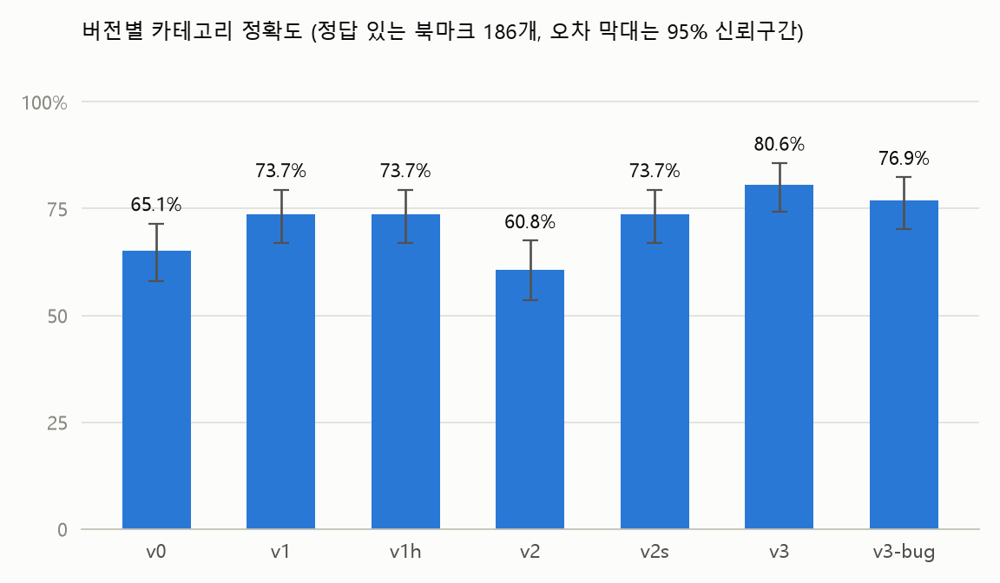
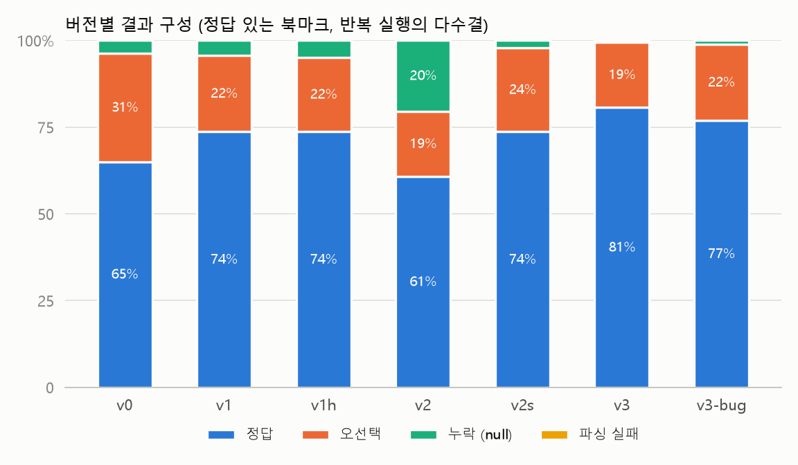
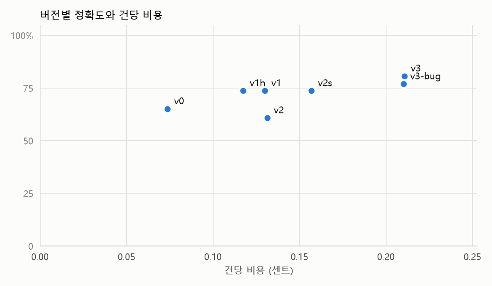

# Today Bookmark AI 분류 정량 평가 보고서

평가일: 2026-11-15

## 1. 한 줄 요약

고정 평가셋 199개에서 카테고리 정확도는 초기 버전 **65.1%에서 현재 버전 80.6%로 15.6%p 올랐다** (McNemar p<0.001). 가장 효과가 컸던 개선은 **본문 보강**(확장 메타데이터와 X 링크의 Jina Reader 본문, +8.6%p)이고, 그다음이 few-shot 예시(+7.0%p)다. 카테고리 설명과 하이퍼파라미터 조정은 정확도를 바꾸지 못했고, 현재 버전은 어느 카테고리에도 맞지 않는 북마크 13개를 전부 억지로 배정했다.

## 2. 평가 설정

| 항목 | 내용 |
|---|---|
| 평가셋 | 199개. 정답이 있는 북마크 186개, 어느 카테고리에도 맞지 않는 북마크(NONE) 13개 |
| 구성 | X(트위터) 링크 152개, 일반 웹 페이지 47개 |
| X 링크 | 실제 저장된 북마크 483개에서 카테고리별 층화 추출. 정답은 사용자가 저장한 카테고리 |
| 일반 웹 페이지 | 사용자가 평가용으로 따로 고르고 직접 라벨링한 링크 (수집 실패 3개 제외 후 47개) |
| 카테고리 | 7개. 그중 6개에 설명이 있고 1개(취미)는 설명이 비어 있음 |
| 경계 사례 | 2개 (두 번째 카테고리도 정답 처리) |
| 모델 | `claude-haiku-4-5-20251001` (앱과 동일) |
| 반복 | 버전당 3회, 총 4,179회 호출, 실패 0회 |
| 총비용 | $6.15 |

지켜진 조건은 다음과 같다.

- 모든 버전이 같은 스냅샷(한 번 수집한 입력)을 쓴다.
- few-shot 예시와 태그 풀은 대상 북마크보다 먼저 저장된 북마크에서만 만든다. 대상 자신은 들어가지 않는다.
- 주 비교는 모든 버전에 현재 파서를 적용했고, 버전의 원래 파서 결과는 따로 기록했다.
- 정확도, 오선택, 누락, 억지 배정은 3회 반복의 다수결로 북마크당 하나의 결과를 정해 계산했다.

### 버전 정의

git 히스토리에는 초기 버전(`4568d01`)과 현재 버전(`73dc486`, `e0d0196`)만 있다. 개선이 한 커밋에 모두 들어갔기 때문에, 중간 버전은 개선을 하나씩 얹어 **재구성한** 버전이다.

| 버전 | 직전 버전에서 바뀐 것 |
|---|---|
| v0 | 초기 버전. title, url, description, 카테고리 이름, 전체 태그. max_tokens 128, temperature 기본값 |
| v1 | + site, keywords, 본문 800자 (X 링크는 Jina Reader 본문) |
| v1h | + max_tokens 400, temperature 0, 태그 상위 50개 |
| v2 | + 카테고리 설명 (초기 프롬프트 틀에 그대로 얹음) |
| v2s | + system 프롬프트 분리. "가능하면 카테고리를 고르라"는 규칙 포함 |
| v3 | + 최근 분류된 북마크 5개를 few-shot 예시로 사용. **현재 앱** |
| v3-bug | v3의 few-shot 예시 5개 중 2개를 미분류(null)로 바꿈. 1차 회귀를 인위적으로 재현 |

## 3. 버전별 지표

| 버전 | 정확도 (95% CI) | 오선택 | 누락 | 억지 배정 | 3회 일관성 | 태그 Jaccard | 입력 / 출력 토큰 | 건당 비용 | 응답 p50 / p90 |
|---|---|---|---|---|---|---|---|---|---|
| v0 | 65.1% (58.0~71.5) | 31.2% | 3.8% | 100% | 93.5% | 0.33 | 546 / 38 | $0.00074 | 675 / 783 ms |
| v1 | 73.7% (66.9~79.5) | 22.0% | 4.3% | 84.6% | 95.5% | 0.35 | 1092 / 42 | $0.00130 | 786 / 993 ms |
| v1h | 73.7% (66.9~79.5) | 21.5% | 4.8% | 100% | 98.5% | 0.31 | 967 / 42 | $0.00118 | 837 / 1068 ms |
| v2 | 60.8% (53.6~67.5) | 18.8% | 20.4% | 69.2% | 99.5% | 0.33 | 1093 / 44 | $0.00131 | 738 / 887 ms |
| v2s | 73.7% (66.9~79.5) | 24.2% | 2.2% | 100% | 100% | 0.35 | 1377 / 38 | $0.00157 | 794 / 890 ms |
| **v3** | **80.6% (74.4~85.7)** | 18.8% | 0.5% | 100% | 100% | 0.49 | 1997 / 22 | $0.00211 | 770 / 901 ms |
| v3-bug | 76.9% (70.3~82.4) | 22.0% | 1.1% | 100% | 100% | 0.52 | 1992 / 22 | $0.00210 | 760 / 884 ms |

- 정확도, 오선택, 누락: 정답이 있는 186개 기준. 신뢰구간은 Wilson 95%.
- 억지 배정: NONE 13개 기준. 표본이 작아 한 건이 7.7%p다.
- 누락: 모델이 null을 반환했거나 목록에 없는 카테고리 이름을 답한 경우. 앱은 두 경우 모두 아무것도 선택하지 않는다.
- 태그 Jaccard: 저장된 태그가 있는 북마크에서 예측 태그와의 유사도 평균.

### 파싱 실패율

| 버전 | 현재 파서 | 버전의 원래 파서 |
|---|---|---|
| v0 | 0.0% | 0.2% |
| v1, v1h | 0.0% | 1.0% |
| v2 | 0.0% | 0.5% |
| v2s, v3, v3-bug | 0.0% | 0.0% |

v0~v2의 원래 파서는 초기 버전의 것(코드펜스를 벗기고 전체를 `JSON.parse`)이다. 응답이 `max_tokens`에 걸려 잘린 경우는 어느 버전에서도 없었다. 2차 회귀를 일으킨 assistant prefill 방식은 코드가 git에 남아 있지 않아 재현하지 않았다.

### 인접 버전 비교 (McNemar 정확 검정, 같은 북마크끼리 짝지음)

| 비교 | 정확도 변화 | 고쳐짐 / 망가짐 | p |
|---|---|---|---|
| v0 → v1 | +8.6%p | 20 / 4 | 0.002 |
| v1 → v1h | 0.0%p | 6 / 6 | 1.000 |
| v1h → v2 | -12.9%p | 3 / 27 | <0.001 |
| v2 → v2s | +12.9%p | 30 / 6 | <0.001 |
| v2s → v3 | +7.0%p | 15 / 2 | 0.002 |
| v3-bug → v3 | +3.8%p | 9 / 2 | 0.065 |
| v0 → v3 | +15.6%p | 31 / 2 | <0.001 |

### 하위 그룹 (v3)

| 그룹 | 북마크 수 | 정확도 (95% CI) |
|---|---|---|
| X 링크 | 152 | 78.9% (71.8~84.7) |
| 일반 웹 페이지 | 34 | 88.2% (73.4~95.3) |
| 뷰티, 취준, 컴퓨터, 패션 | 18, 22, 18, 14 | 각각 100% |
| 웃기고좋은거 | 18 | 83.3% (60.8~94.2) |
| 취미 | 57 | 66.7% (53.7~77.5) |
| 라이프 | 39 | 64.1% (48.4~77.3) |

X 링크는 v0 61.2% → v3 78.9%, 일반 웹 페이지는 v0 82.4% → v3 88.2%다. 버전 전체의 하위 그룹 수치는 `subgroup_x.csv`, `subgroup_category.csv`에 있다.

## 4. 그래프

## 5. 개선별 효과 해석

**본문 보강 (v0 → v1): +8.6%p, 유의함.** 가장 큰 개선이다. X 링크에서 61.2% → 71.1%로 올랐다. 이 평가셋의 X 북마크는 제목에 트윗 첫 문장이 이미 들어 있어서 초기 버전도 정보가 아주 없지는 않았는데, 타래 전체 본문이 더해지자 오선택이 31.2%에서 22.0%로 줄었다. 대가는 입력 토큰 2배(546 → 1092)다.

**하이퍼파라미터 (v1 → v1h): 정확도 변화 없음.** 고쳐진 것 6건, 망가진 것 6건으로 서로 상쇄됐다. 효과는 안정성 쪽에 있다. 3회 반복이 모두 같은 답을 낸 비율이 95.5%에서 98.5%로 올랐다. max_tokens 128에서도 응답이 잘린 적이 없으므로, "응답이 잘린다"는 초기 문제는 이 평가셋에서는 관찰되지 않았다.

**카테고리 설명 (v1h → v2 → v2s): 정확도를 올리지 못함.** v2의 60.8%는 그대로 받아들이면 안 된다. 초기 프롬프트 틀에 `- 이름: 설명` 목록을 넣자 응답의 14.1%가 카테고리를 `"이름: 설명"` 통째로 답했고, 목록에 없는 이름이라 미선택으로 처리됐다. 이런 답을 이름으로 인정하면 호출 기준 정확도는 약 74.7%로 v1h(73.3%)와 비슷하다. v2는 실제로 존재한 적 없는 재구성 버전이므로 이 하락은 "설명을 넣는 방식에 따라 출력 형식이 깨질 수 있다"는 사례로만 읽어야 한다. 형식 문제가 없는 v2s(설명 + system 분리)도 73.7%로 v1h와 같다. 즉 설명과 system 프롬프트 분리를 합쳐도 정확도 이득은 없었고, 누락만 4.8%에서 2.2%로 줄었다.

**few-shot (v2s → v3): +7.0%p, 유의함.** 15건이 고쳐지고 2건이 망가졌다. 누락은 2.2%에서 0.5%로 줄고, 태그 Jaccard는 0.35에서 0.49로 올랐다. 사용자가 실제로 쓰는 태그와 분류 습관을 예시로 보여 준 효과로 보인다. 출력 토큰도 38에서 22로 줄었는데, 예시를 따라 코드펜스 없이 JSON만 답하기 때문이다. 대가는 입력 토큰 45% 증가(1377 → 1997)다.

**1차 회귀 재현 (v3-bug): 재현되지 않음.** few-shot 예시 5개 중 2개를 null로 바꿔도 누락은 0.5% → 1.1%로 거의 그대로였다. 정확도는 3.8%p 낮았지만 유의하지 않다(p=0.065). 당시에는 필터링과 "가능하면 카테고리를 고르라"는 system 규칙을 함께 넣었는데, 지금은 system 규칙이 남아 있어서 null 예시의 영향을 막는 것으로 보인다. 다만 이 조건은 당시 데이터가 아니라 인위적으로 만든 것이다.

**전체 (v0 → v3): +15.6%p.** 건당 비용은 $0.00074에서 $0.00211로 2.9배가 됐다. 응답 시간은 중앙값 0.68초에서 0.77초로 큰 차이가 없다.

## 6. 오류 분석 (v3)

정답이 있는 186개 중 36개를 틀렸다. 오선택 35건, 누락 1건이다. 원인 분류는 응답과 입력을 읽고 판단한 것으로, 한 건에 원인 하나만 붙였다.

| 원인 | 건수 | 내용 |
|---|---|---|
| 카테고리 경계가 애매함 (취미) | 20 | 취미와 다른 카테고리 사이의 혼동. 취미 → 웃기고좋은거가 가장 많다. 취미는 설명이 비어 있는 유일한 카테고리다 |
| 카테고리 설명이 좁음 (라이프) | 9 | 라이프 설명은 "생활에 도움이 되는 것, 운동"인데, 실제로는 책이나 영상 추천, 생활용품 같은 글도 라이프로 저장되어 있다 |
| 입력 정보 부족 | 7 | 비공개 또는 로그인 전용 트윗 3건, 서버 요청이 막힌 쇼핑몰과 블로그 3건, 본문 대신 사이트 하단 문구가 잡힌 영상 페이지 1건 |

혼동 쌍으로 보면 취미 → 웃기고좋은거 13건, 라이프 → 웃기고좋은거 6건, 취미 → 라이프 4건, 웃기고좋은거 → 취미 3건이 전체의 72%다.

억지 배정 13건은 라이프 4, 컴퓨터 4, 취준 2, 웃기고좋은거 1, 뷰티 1, 패션 1로 흩어졌다. NONE 중에는 카테고리 설명만 보면 기존 카테고리에 들어갈 여지가 있는 것도 있어서, 일부는 라벨 기준(사용자가 저장하지 않을 글)과 모델이 보는 기준(카테고리 설명에 맞는 글)의 차이다.

## 7. 한계

- **표본 크기**: 정확도 95% 신뢰구간이 ±6~7%p다. 3~4%p 차이(예: v3와 v3-bug)는 구분할 수 없다. NONE은 13개, 일반 웹 페이지는 34개뿐이라 이 그룹의 수치는 경향으로만 봐야 한다.
- **재구성한 중간 버전**: v1, v1h, v2, v2s는 실제로 배포된 적이 없다. 개선을 얹는 순서와 방식은 평가자가 정했고, v2의 형식 문제처럼 재구성 방식이 결과에 영향을 준다.
- **라벨 편향**: X 링크의 정답은 사용자가 저장한 카테고리다. AI 추천을 그대로 수락했는지 직접 고쳤는지 구분하는 기록이 없어서, AI 추천 쪽으로 기운 라벨이 섞여 있을 수 있다. 일반 웹 페이지는 평가용으로 따로 고른 링크라 실제 저장 분포와 다르다.
- **카테고리 설명의 유리함**: 설명은 실패 사례를 본 뒤에 쓴 것이라 v2 이상에 유리할 수 있다. 그런데도 설명의 효과는 관찰되지 않았다.
- **서버 HTML과 브라우저 DOM의 차이**: 앱은 렌더링된 페이지의 `innerText`를 읽지만 평가는 서버 HTML의 `textContent`를 읽는다. 일반 웹 페이지 9개는 서버 요청이 막혀 Jina Reader로 대신 수집했고, 영상 페이지는 본문 자리에 사이트 하단 문구가 들어갔다.
- **Jina 타임아웃**: 앱은 2.5초 안에 응답이 없으면 본문 없이 추천한다. 평가는 30초까지 기다렸으므로 v1 이상의 수치는 실제 사용보다 유리하다.
- **현재 시점의 카테고리와 본문**: 카테고리 목록과 설명은 지금의 것을 썼고, 트윗 본문도 지금 수집했다. 저장 당시와 다를 수 있다.
- **회귀 재현의 인위성**: v3-bug는 당시 상태가 아니라 만든 조건이다. prefill 회귀는 재현하지 못했다.
- **평가셋 간 예시 공유**: v3 호출의 88%에서 few-shot 예시 중 하나 이상이 평가셋의 다른 북마크였다. 대상보다 먼저 저장된 북마크만 쓰므로 실제 사용 상황과 같지만, 북마크들이 서로 독립은 아니다.

## 8. 다음에 개선할 점

1. **취미 카테고리에 설명 추가**, 라이프 설명 넓히기. 오류 36건 중 29건이 이 두 카테고리의 경계 문제다. 설명을 고친 뒤 같은 평가셋으로 다시 측정하되, 다른 카테고리의 정확도가 떨어지지 않는지 함께 본다.
2. **억지 배정 줄이기**. "가능하면 카테고리를 고르라"는 규칙이 누락을 0.5%까지 낮췄지만 거부를 전혀 못 하게 만들었다. NONE 표본을 30개 이상으로 늘린 뒤, 규칙 문구를 조정하면서 누락률과 억지 배정률을 같이 본다.
3. **입력이 비었을 때의 처리**. 비공개 트윗이나 로그인 벽 문구가 본문으로 들어오면 버리고, 그 경우 추천의 신뢰도가 낮다는 표시를 한다.
4. **운영 지표 로깅**. 추천을 사용자가 바꿨는지 기록하면 라벨 편향 없이 실제 수정률을 추적할 수 있다.
5. **비용**. 입력 토큰의 약 30%가 few-shot 예시다. 예시 수를 3개로 줄였을 때의 정확도를 측정해 볼 만하다.

## 9. 카테고리 설명 자동 개선 실험

6장의 오류 대부분이 카테고리 설명 문제였으므로, 설명을 LLM으로 고쳐 쓰면 나아지는지 확인했다.

**방법**

1. 평가셋 199개를 정답 카테고리별로 층화해 dev 99개와 test 100개로 나눴다.
2. dev에서 현재 버전(v3)이 틀린 24건과 현재 설명을 `claude-opus-5-5`에 넘겨 설명 수정안을 한 번 받았다. test 북마크는 보여 주지 않았다.
3. 수정안은 7개 카테고리 중 5개의 설명을 바꿨다. 비어 있던 설명 1개를 새로 썼고, 나머지는 범위를 넓히거나 헷갈리는 카테고리와의 구분 기준을 덧붙였다. 설명 길이는 평균 12자에서 59자로 늘었다.
4. 설명만 수정안으로 바꾼 버전(v3d)을 199개 전체에 3회씩 실행해 v3와 비교했다. 분류 모델과 나머지 조건은 같다.

**결과**

| 셋 | 대상 | 개수 | 수정 전 | 수정 후 | 변화 | 고쳐짐 / 망가짐 | McNemar p |
|---|---|---|---|---|---|---|---|
| dev | 정답 있는 북마크 전체 | 93 | 80.6% | 83.9% | +3.2%p | 6 / 3 | 0.508 |
| dev | 설명을 바꾼 카테고리 | 77 | 76.6% | 81.8% | +5.2%p | 6 / 2 | 0.289 |
| dev | 설명을 안 바꾼 카테고리 | 16 | 100% | 93.8% | -6.2%p | 0 / 1 | 1.000 |
| **test** | **정답 있는 북마크 전체** | 93 | 80.6% (71.5~87.4) | 87.1% (78.8~92.5) | **+6.5%p** | 7 / 1 | 0.070 |
| test | 설명을 바꾼 카테고리 | 77 | 76.6% | 84.4% | +7.8%p | 7 / 1 | 0.070 |
| test | 설명을 안 바꾼 카테고리 | 16 | 100% | 100% | 0.0%p | 0 / 0 | 1.000 |
| dev, test | NONE (정상 거부율) | 6, 7 | 0% | 0% | 0.0%p | 0 / 0 | 1.000 |

카테고리별로는 test에서 라이프 65.0% → 80.0%, 취미 64.3% → 78.6%로 올랐다. 전체 표는 `phase7_table.md`, `phase7_by_category.csv`에 있다.

**해석**

- **test에서 +6.5%p 올랐지만 유의수준 5%에는 못 미친다** (p=0.070). 표본이 93개라서 이 정도 차이를 확정하기에는 부족하다. 방향은 일관된다. 7건이 고쳐지고 1건이 망가졌다.
- **과적합의 징후는 없다.** dev(+3.2%p)보다 test(+6.5%p)에서 더 올랐다. dev에서만 오르고 test에서는 안 오르는 모양이 아니다.
- **다른 카테고리가 망가지는 부작용은 작지만 있었다.** 설명을 안 바꾼 카테고리에서 dev 1건, 설명을 바꾼 카테고리 중 원래 100%였던 곳에서 test 1건이 새로 틀렸다. 설명끼리 서로 경쟁한다는 점이 실제로 관찰된 셈이다.
- **억지 배정은 그대로다.** NONE 13개를 수정 후에도 전부 어떤 카테고리에 넣었다. 설명에 "제외" 조건을 적는 것만으로는 거부하게 만들지 못했다.
- **비용**: 설명이 길어져 입력 토큰이 1997에서 2262로 13% 늘었다 (건당 $0.00211 → $0.00237).
- 수정안에는 dev 실패 사례에서 온 구체적인 품목이 몇 개 들어 있다. 그대로 쓰기보다 일반적인 표현으로 다듬는 편이 낫다.

수정안은 평가 안에서만 썼고, 앱과 DB의 카테고리 설명은 바꾸지 않았다. 실험 비용은 수정안 생성 1회와 재실행 597회를 합쳐 약 $1.5다.
